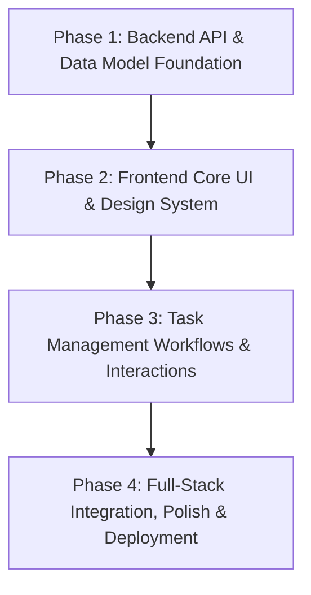

# Project Roadmap: To-Do List Mobile App (MERN Stack)

## Milestone Overview: v1.0.0 (Assessment Submission)

The goal of this milestone is to deliver a fully functional, mobile-responsive, production-grade MERN Stack To-Do List Application matching the assessment requirements and Figma designs, complete with test coverage and deployment scripts.

---

### Phase 1: Backend API & Data Model Foundation
- **Goal**: Build a robust, tested Node.js/Express REST API backed by MongoDB/Mongoose with full task CRUD, search filtering, weekly statistics aggregation, input validation, and automated integration tests.
- **Requirements Covered**: REQ-TASK-01, REQ-TASK-02, REQ-TASK-03, REQ-TASK-04, REQ-TASK-05, REQ-WEEK-01, REQ-API-01, REQ-API-02, REQ-API-03.
- **Plans**:
  - `01-01-PLAN.md`: Core Express Server, MongoDB Connection, Task Mongoose Model & CRUD Endpoints (Tracer Plan)
  - `01-02-PLAN.md`: Validation Middleware, Weekly Stats Aggregator, Search Endpoint & Automated Test Suite
- **Success Criteria**:
  1. Express server starts cleanly with MongoDB connectivity.
  2. All REST endpoints (`GET`, `POST`, `PUT`, `PATCH`, `DELETE`, `/stats/weekly`) return expected JSON structures with proper HTTP status codes.
  3. Weekly summary correctly groups tasks from Monday to Sunday and calculates open vs completed counts.
  4. Integration tests pass 100%.

---

### Phase 2: Frontend Core UI & Design System
- **Goal**: Implement the mobile-first UI foundation using React 19, TypeScript, and Tailwind CSS matching the Figma color palette, fonts, Onboarding Screen with hero graphic, Calendar Strip selector, and Weekly Summary Cards.
- **Requirements Covered**: REQ-WEEK-02, REQ-WEEK-03, REQ-WEEK-04, REQ-UI-01, REQ-UI-02, REQ-UI-05.
- **Plans**:
  - `02-01-PLAN.md`: Tailwind CSS setup, mobile viewport frame wrapper, theme tokens, and Onboarding Screen.
  - `02-02-PLAN.md`: Home Screen skeleton, Day picker calendar strip, Weekly Progress Bar, and Task Summary Cards.
- **Success Criteria**:
  1. Mobile container displays centered on desktop with proper aspect ratio and shadow, and responsive on mobile screens.
  2. Onboarding screen renders Figma graphics (`onboarding-bg.png`) with persistent navigation state.
  3. Calendar strip dynamically renders the 7 days of the active week with active day selection.
  4. Summary cards ("Task Complete" and "Task Pending") and progress bar render with Figma colors.

---

### Phase 3: Task Management Workflows & Interactions
- **Goal**: Implement the dynamic task list, status toggling, Add/Edit task bottom sheet modal, swipe-left deletion gesture, and the dedicated Search screen matching Figma Frame 9.
- **Requirements Covered**: REQ-TASK-01, REQ-TASK-02, REQ-TASK-03, REQ-TASK-04, REQ-TASK-05, REQ-UI-03, REQ-UI-04.
- **Plans**:
  - `03-01-PLAN.md`: Task Item component (checkbox, strikethrough, trash/edit buttons, touch swipe-to-delete gesture).
  - `03-02-PLAN.md`: Add/Edit Task Bottom Sheet Modal with time/date pickers, priority selector, and form validation.
  - `03-03-PLAN.md`: Dedicated Search Screen (Frame 9) with real-time text query filtering and task action handlers.
- **Success Criteria**:
  1. Users can add tasks with title, start/end time, date, description, and priority.
  2. Tapping checkbox toggles completion status with smooth strikethrough animation.
  3. Users can swipe left on any task row or click the trash icon to delete.
  4. Dedicated search view allows finding tasks across title and description instantly.

---

### Phase 4: Full-Stack Integration, State Sync, Polish & Deployment
- **Goal**: Wire the React frontend to the Express backend with optimistic UI updates, loading/empty states, database seeding, Netlify deployment configuration, and comprehensive documentation.
- **Requirements Covered**: REQ-DEP-01, All End-to-End User Flows.
- **Plans**:
  - `04-01-PLAN.md`: Frontend API client integration, state synchronization, and optimistic UI mutations.
  - `04-02-PLAN.md`: Database seeder with realistic test data, edge cases, and empty state illustrations.
  - `04-03-PLAN.md`: Netlify configuration (`netlify.toml`), backend production configuration, and submission documentation.
- **Success Criteria**:
  1. Frontend seamlessly performs CRUD operations against backend API.
  2. Weekly stats and daily lists reflect database changes immediately.
  3. Application builds cleanly with `npm run build` in both Frontend and Backend.
  4. Netlify deployment configuration and production environment variables documented and verified.

